# NaijaStock Distributors Ltd – Sales and Distribution Performance Analysis Using Power BI

## Introduction
 
NaijaStock Distributors Ltd is a growing Nigerian distribution company supplying packaged foods, beverages, and household products to retailers and wholesalers across different regions of the country.
As the business expanded, managing sales performance, product distribution, warehouse operations, and supplier relationships became increasingly complex. The lack of a consolidated reporting system made it difficult for management to obtain timely and consistent information for decision-making.
This project focuses on developing an interactive Business Intelligence dashboard using Microsoft Power BI to analyse the company's sales and distribution performance. The dashboard provides insights into revenue generation, product performance, warehouse efficiency, supplier contributions, and order-level transactions.
Through data cleaning, data modelling, DAX calculations, and interactive visualisations, the project transforms raw sales records into a centralised reporting solution that supports data-driven business decisions.

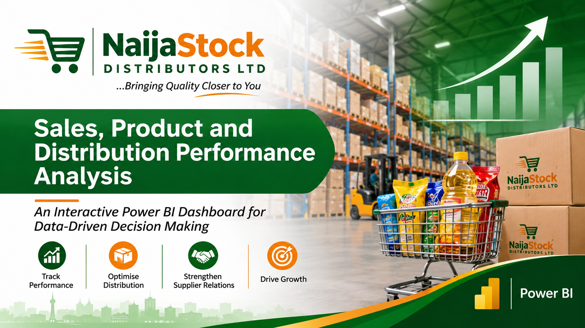

## About the Dataset 

The dataset contains sales transaction records and supporting information relating to products, warehouses, suppliers, and customers.
It consists of five main tables:

Table	Description
- Fact_Sales	Contains transaction-level information, including sales ID, order ID, transaction date, quantity, unit price, discount, revenue, cost, and profit.
- Dim_Product	Contains product names, categories, subcategories, brands, and units of measurement.
- Dim_Warehouse	Contains warehouse names, regions, states, and warehouse managers.
- Dim_Supplier	Contains supplier names, supplier types, countries, and delivery lead times.
- Dim_Customer	Contains customer names, customer types, and regions.

## Problem Statement
NaijaStock Distributors Ltd experienced challenges in consolidating sales information and monitoring business performance across its various operational departments.
The absence of a unified reporting system made it difficult to:
-	Monitor overall revenue, profit, sales volume, and order performance.
-	Identify products and categories contributing the most to revenue.
-	Compare warehouse performance across different regions.
-	Evaluate supplier contributions, costs, and delivery lead times.
-	Monitor monthly and yearly sales trends.
-	Identify areas of declining performance and opportunities for improvement.
The objective of this project was to develop an interactive Power BI dashboard that consolidates these business metrics, provides visibility into operational performance, and enables management to make informed decisions 

## Tools used

Microsoft Power BI, Power Query, DAX.

## Data preparation and Visualizations

The project involved:

###	Cleaning and preparing the raw datasets for analysis.

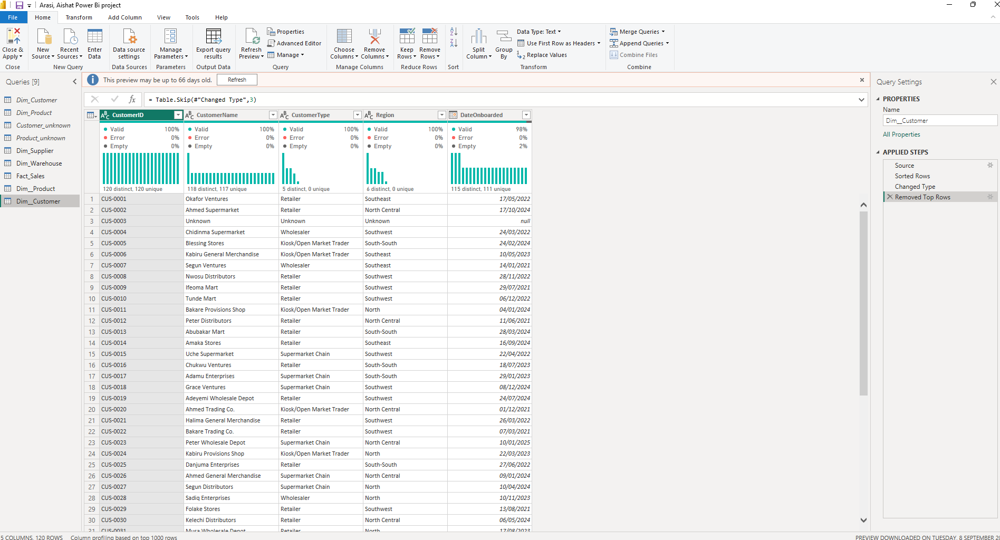

###	Creating relationships between the fact table and dimension tables and developing a star schema data model.

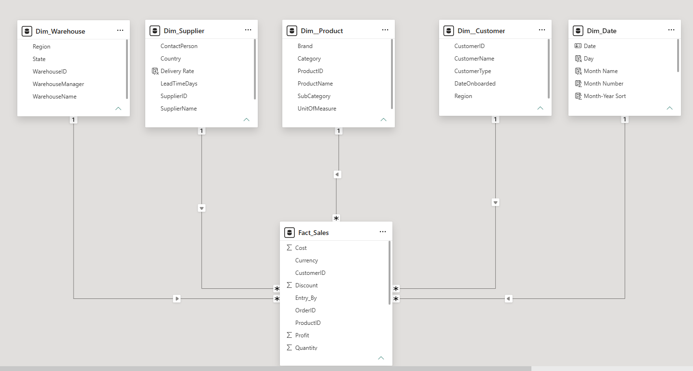

###	Creating a dedicated calendar table for time-based analysis.:
A dedicated Calendar table was created instead of relying on Power BI's Auto Date/Time feature. This was done because the Onboarding Date in one of the dimension tables was creating potential date relationship conflicts with the Order Date, so a separate calendar table provided better control over time-based analysis and ensured accurate sales trend calculations.
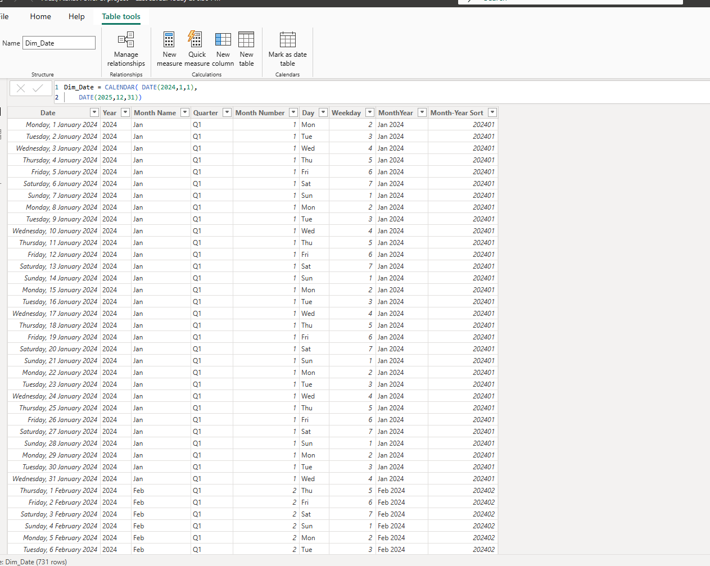

### Developing DAX measures to calculate business performance indicators.

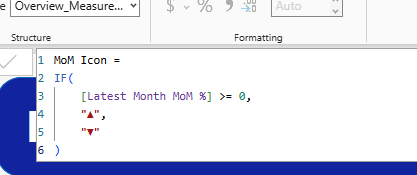

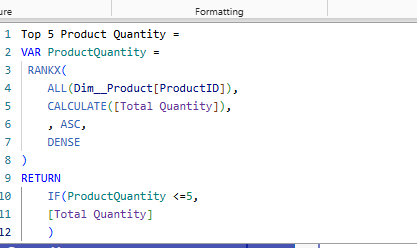

### Page Navigator: Icon-based page navigation was implemented to allow users to move easily between the different dashboard pages. Each icon serves as a navigation button, providing a simple and interactive way to switch between the Overview, Product, Warehouse, and Supplier pages. A reset icon can be used to clear all filters.

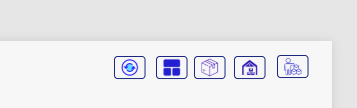

###	Building interactive dashboards with slicers for filtering and exploration.

#### Overview Page
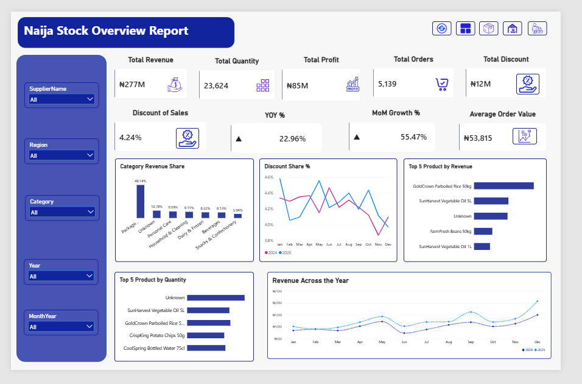

#### Product Page
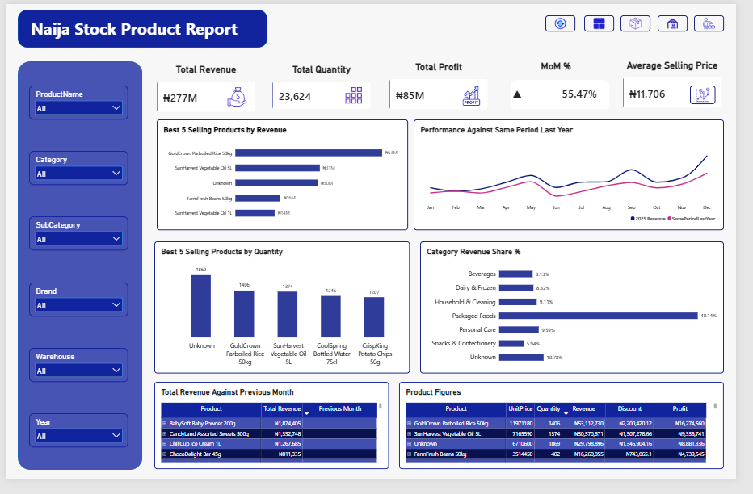

#### Warehouse Page
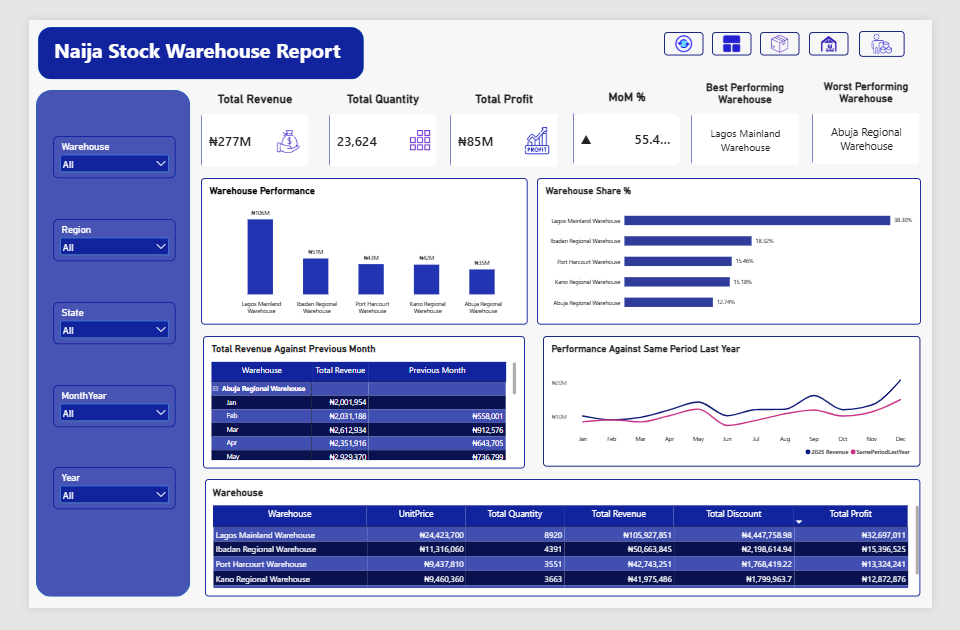

#### Supplier Page
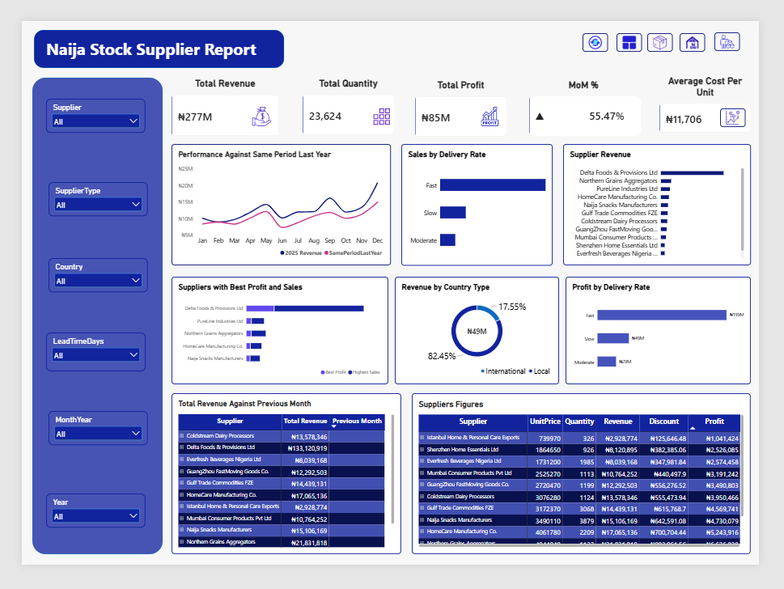

### Drill Through: Drill-through allows users to navigate from a summary visual to a dedicated detail page, providing a closer look at specific products, warehouses, or suppliers.

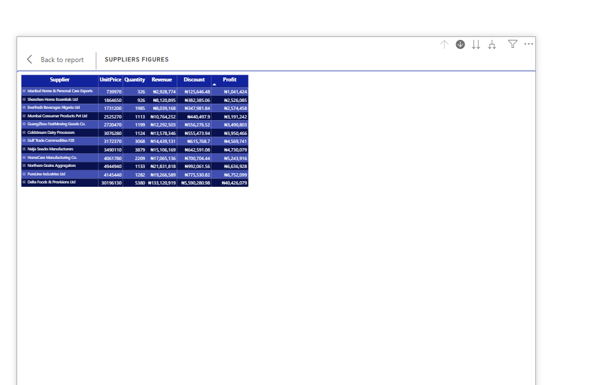
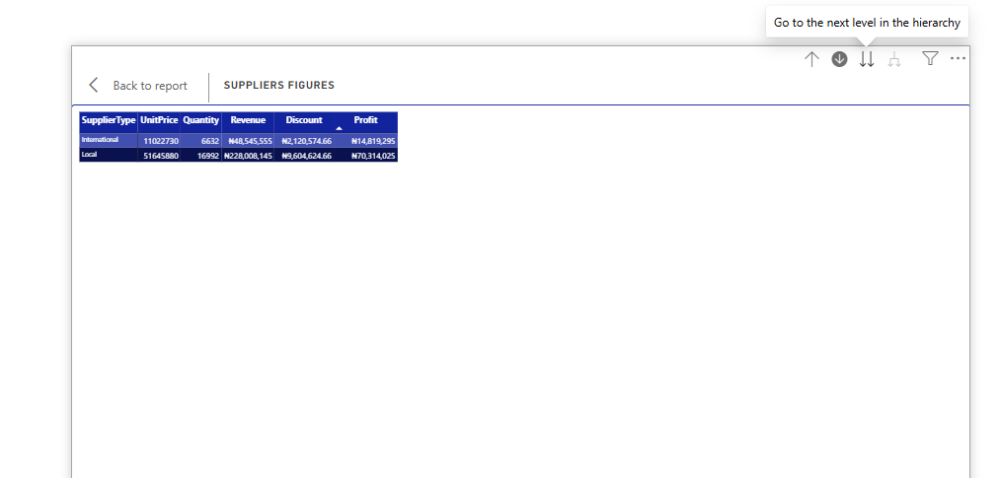

### Edit Interactions was used to control how visuals respond to one another by disabling unwanted interactions. This ensures that selecting data in one visual does not affect other visuals where such interaction is unnecessary.

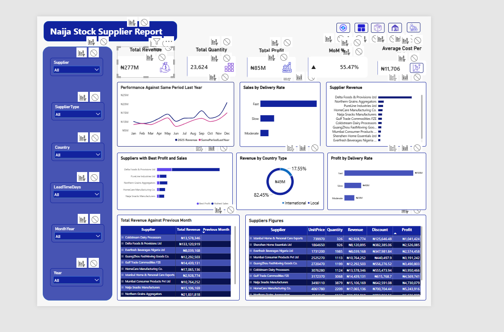

## Key Insights and Analysis

### Overall Business Performance – Overview Page
 
The Overview page provides a consolidated view of NaijaStock Distributors Ltd's overall business performance.
The analysis focuses on the following indicators:
1. Revenue and Profitability Performance:
-	Total Revenue measures the overall sales value generated during the selected period.
-	Total Profit provides an indication of the company's profitability.
-	Total Quantity measures the volume of products sold.
-	Total Orders shows the number of orders processed.
-	Average Order Value (AOV) measures the average revenue generated per order.
These indicators provide management with an overview of sales activity, business growth, and financial performance.
2. Monthly and Yearly Revenue Trends:
The revenue trend visualisation provides insight into how sales performance changes over time.
The Month-over-Month (MoM) Growth and Year-over-Year (YoY) Growth measures help management identify increases or decreases in revenue compared with previous periods.
This comparison helps distinguish sustained business growth from seasonal changes in sales.
3. Discount Analysis:
The Discount Share (%) visual examines the proportion of sales value given up through discounts.
This analysis helps management assess the company's discounting practices and understand how promotional activities may affect revenue and profitability.
4. Category Revenue Contribution:
The Category Revenue Share visual identifies how much each product category contributes to overall revenue.
It allows management to understand which categories generate the greatest sales value and which may require additional attention.
5. Top-Performing Products:
The dashboard separately identifies the top five products by revenue and the top five products by quantity sold.
This distinction is important because products with high sales volumes do not necessarily generate the highest revenue.

### Product Performance Analysis – Product Page
 
The Product page examines sales performance across individual products, categories, subcategories, and brands.
1. Product Revenue and Profitability:
The dashboard evaluates total revenue, total profit, quantity sold, and average selling price.
These indicators help identify products that generate substantial revenue and those that contribute more significantly to profitability.
2. Category Revenue Contribution:
The Category Revenue Share (%) measure shows the contribution of individual categories to the company's overall revenue.
This provides a basis for evaluating the financial importance of each category within the business.
3. Best-Selling Products:
The dashboard identifies the five best-selling products by revenue and the five best-selling products by quantity.
This allows product managers to distinguish between products with high demand and products with high financial contribution.
4. Monthly Sales Performance:
The Month-over-Month comparison measures changes in product sales relative to the previous month.
The comparison with the same period in the previous year also provides an opportunity to identify seasonal patterns and changes in customer demand.
5. Product-Level Comparison:
The Product Figures table provides a consolidated view of product performance, allowing managers to compare products and narrow their analysis using category, subcategory, brand, and warehouse filters.

### Warehouse Performance Analysis – Warehouse Page
 
The Warehouse page evaluates the performance of the company's distribution centres across different locations.
1. Warehouse Revenue and Profitability:
The dashboard examines total revenue, quantity dispatched, and profit generated by each warehouse.
These indicators help management assess the financial contribution and operational activity of individual warehouses.
2. Warehouse Revenue Contribution:
The Warehouse Share (%) measure evaluates the proportion of total company revenue associated with each warehouse.
This allows management to compare the contribution of different distribution locations.
3. Best and Worst Performing Warehouses:
The dashboard identifies the best-performing and worst-performing warehouses based on the performance measure used in the report.
This comparison helps management recognise strong-performing locations and identify warehouses that may require operational review.
4. Monthly Warehouse Performance:
The Month-over-Month comparison tracks changes in warehouse revenue against the previous month.
The comparison with the same period in the previous year provides additional context for evaluating warehouse performance over time.
5. Regional and Warehouse Comparison:
The Warehouse Performance visual and comparison table allow management to examine differences across warehouses, regions, and states.
This supports better evaluation of distribution performance and resource allocation.

### Supplier Performance Analysis – Supplier Page
 
The Supplier page evaluates supplier contributions to the company's sales and profitability while examining delivery lead times and supplier classifications.
1. Supplier Revenue and Profitability:
The dashboard examines total revenue, total profit, quantity sold, and average cost per unit associated with products supplied by each supplier.
These measures help the procurement team understand the financial contribution of individual suppliers.
2. Supplier Revenue Contribution:
The Supplier Revenue visual examines the percentage contribution of each supplier to overall company revenue.
This helps identify suppliers whose products account for a substantial proportion of business sales.
3. Local and International Supplier Comparison:
The Revenue by Country Type visual compares the performance of local and international suppliers.
This provides management with an overview of how the two supplier groups contribute to the company's revenue.
4. Supplier Delivery Lead-Time Analysis:
The Sales by Delivery Rate and Profit by Delivery Rate visuals examine supplier performance according to delivery lead-time groups.
The analysis considers suppliers with delivery periods of:
-	1–5 days.
-	6–10 days.
-	11 days or more.
This helps procurement assess the relationship between supplier delivery timelines, sales performance, and profitability.
5. Supplier Performance Over Time:
The Month-over-Month and Year-over-Year comparisons provide insight into changes in supplier-related sales performance.
The supplier comparison table also allows the procurement team to evaluate individual suppliers using their revenue, profit, quantity, and cost figures.

### Order-Level Transaction Analysis
The Order-Level Details page provides access to the underlying sales transaction records.
Unlike the summary pages, which focus on aggregated business performance, this page allows users to examine individual sales records and their associated transaction information.
It supports more detailed investigation of sales activities and provides additional context when reviewing the figures presented in the other dashboard pages.

## Further Recommendations

Based on the business objectives and the analytical capabilities developed in this project, the following recommendations are proposed:
1. Strengthen product management: Management should regularly review product revenue, quantity sold, and profitability to identify products that deserve increased attention in inventory and sales planning.
2. Improve warehouse operations: Warehouses with consistently lower revenue or declining performance should be reviewed to identify possible distribution, demand, or operational challenges.
3. Optimise supplier relationships: Procurement should evaluate suppliers using profitability, average cost per unit, and delivery lead time rather than relying exclusively on purchase cost.
4. Review discounting strategies: Management should monitor discount levels and their relationship with profit to ensure that promotional activities support sustainable revenue generation.
5. Improve demand forecasting: Historical monthly and yearly sales trends should be used to anticipate demand changes and support inventory planning.
6. Maintain regular performance monitoring: The dashboard should be updated regularly so that management can monitor business performance and respond to emerging changes.

## Conclusion

This project demonstrates how Power BI can be used to transform raw sales transaction records into an interactive business intelligence solution.
By consolidating sales, product, warehouse, supplier, and customer information, the dashboard provides management with a centralised view of business performance.
The five report pages support different levels of analysis, from executive performance monitoring to detailed product, warehouse, supplier, and transaction-level investigations.
The use of Power Query, data modelling, DAX measures, and interactive visualisations makes it possible to explore business performance across different dimensions and time periods.
Overall, the dashboard provides a foundation for more informed decisions concerning revenue growth, product management, warehouse operations, supplier relationships, and business profitability.

